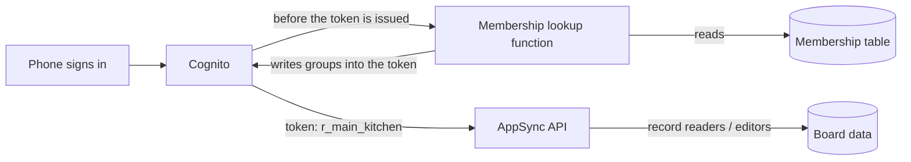

# Self-serve 86 Board: the plan

Status: proposal for review. No code until Ryan has been walked through it.

## In one paragraph

Today the three restaurants, their staff roles and who may do what are written into the code. A new restaurant group can't sign up by itself, and adding a fourth location means a code change and a redeploy. The plan moves all of that into the database: a **Membership** row says "marco.r is kitchen at Main Street". When someone signs in, a small function reads their memberships and writes them into their login token as groups. Everything that already checks groups (the database rules, the board function, live updates) keeps working unchanged. A new owner can then sign up, create their restaurants, load a menu and add staff on day one, with no code change and no redeploy.

## How a sign-in would work

The groups in the token stop being Cognito objects that someone has to create and maintain. They become a label the function writes at sign-in, built from the Membership table, which is the one source of truth.

## What is hard-coded today

| Where | What | Why it blocks self-serve |
|---|---|---|
| `amplify/auth/resource.ts` | 13 Cognito groups: `owner` plus restaurant × role | A new restaurant needs new groups, which means a deploy |
| `amplify/data/resource.ts` | `manageStaff` allowed for `main-manager`, `water-manager`, `counter-manager` | A new restaurant's manager is locked out until the code changes |
| `shared/sample-data.ts` | `RESTAURANTS` and `RESTAURANT_IDS` | The staff rules only accept these three ids |
| Everywhere | One global `owner` | Only one owner can exist; a second company would see the first one's data |
| `Integration` model | One n8n settings row, id `n8n` | Every company would share one webhook and one key |

What is already right, and stays: every record carries its `readers` and `editors` groups, the server stamps names from the login, and all writes go through the board and staff functions.

## Three ways to do it

| | A. Create Cognito groups at runtime | B. Lambda authorizer | C. Groups from the database, written into the token (recommended) |
|---|---|---|---|
| How | The staff function calls `CreateGroup` when a restaurant is added | Every API call goes through our own function that decides yes or no | A pre token generation trigger reads Membership rows and sets `cognito:groups` |
| Source of truth | Two: Cognito groups and the Staff table, which can drift | One: our tables | One: the Membership table |
| Limits | 10,000 groups per pool (about 2,000 restaurants at 4 roles + owner); 100 groups per person; `CreateGroup` at 5 per second | None from Cognito | None from Cognito: the groups are just a list in the token |
| Database rules we have today | Keep working | Replaced: every model moves to custom rules, and list queries must filter by tenant in our own resolvers | Keep working unchanged |
| Live updates (subscriptions) | Keep working | Amplify's docs say nothing about subscriptions with Lambda auth; we would write our own filters | Keep working: the server filters by the groups in the token |
| Cost and speed | No change | A function call on every request (cached for a set time) | A function call at sign-in and at each token refresh: free tier |
| How fast a role change takes effect | At the next token refresh | Immediately | At the next token refresh |
| Size of the change | Medium | Large rewrite | Small to medium |

**Recommendation: C.** It is the only option that removes the hard-coding while keeping the security model Ryan already tested by hand. Every check we have compares group names, and C only changes where those names come from.

### Facts checked for option C

- The trigger works on our current Cognito plan. Version 1 events are the default, and their group override "replaces the `cognito:groups` claim in access tokens and ID tokens." (AWS docs, pre token generation.) No paid feature plan needed.
- The trigger runs at sign-in and at every token refresh. Our access tokens last 5 minutes, so a role change reaches a phone within 5 minutes, the same promise we make today when someone is switched off. After an owner changes their own access (say, creates a restaurant), the app forces a refresh so it shows at once.
- Live updates with group-based rules only work for people in 20 groups or fewer (Amplify docs). A staff member has 1. An owner with a group per restaurant would pass 20 at their 21st location, so owners get **one** organization-level group, `o_<org>_owner`, which goes into every record's readers. Each record keeps 5 or 6 readers, well under the limit of 20.
- Cost: an open board refreshes its token about 12 times an hour. 50 phones for 12 hours a day is about 220,000 calls a month, inside Lambda's free tier of 1 million.

### The risk with C, and how to contain it

If the trigger fails, nobody can sign in. So:

1. It does one read (a query on the Membership table by username) and nothing else.
2. It has its own tests, plus an alarm on errors.
3. The staging security test (PR #9) signs in as every role on every push, so a broken trigger never reaches the live board.

## The data model

- **Org**: the restaurant group. `id`, `name`, `createdBy`.
- **Restaurant**: now data. `id`, `orgId`, `name`, `kind`, `timezone`.
- **Membership**: replaces Cognito group membership. `username`, `orgId`, `restaurantId` (or `*` for an org owner), `role`. One person can have several, for example a manager at two locations.
- **Staff**: stays (display name, switched on or off). Switching someone off also stops the trigger from issuing their groups.
- **MenuItem, EightySixEvent, Vendor, PushSubscription**: gain `orgId`. Their `readers` become `r_<restaurant>_<role>` groups plus `o_<org>_owner`.
- **Integration** (n8n): one row per org instead of one for everybody.

Group names change shape from `main-kitchen` to `r_<restaurantId>_kitchen` and `o_<orgId>_owner`, with restaurant ids that the server generates, so one company can never pick a name that collides with another's.

## The new owner's first day

1. **Sign up** on the public page: name, email, password. Owners sign in with email; staff keep plain usernames.
2. **Name the company** and add the first restaurant. The server creates the Org, the Restaurant and an owner Membership, and the app refreshes the token.
3. **Load the menu**: paste a list (one item per line, with a category), or start from a template.
4. **Add staff** with the login generator we already have. Usernames get a short company code so two companies can both have a `marco.r`: for example `gn.marco.r`.
5. **Hand out the logins.** The board works from that moment.

## Building it: five small pull requests, each through staging

| # | Pull request | What changes for users | Size |
|---|---|---|---|
| 1 | Membership table and the trigger, writing **today's** group names | Nothing. Proves the mechanism with the staging test unchanged | Small |
| 2 | Restaurants become data: the code stops using `RESTAURANTS` and the static groups | Nothing visible. A fourth restaurant can be added without a deploy | Medium |
| 3 | Orgs: org owner group, n8n settings and reports per org | Nothing for Dana's group. Ready for a second company | Medium |
| 4 | Sign-up, onboarding and menu import | New companies can join | Large |
| 5 | Move the live data to the new names; delete the old Cognito groups | Nothing visible | Small |

During PRs 1 to 4 the trigger writes both the old names (`main-kitchen`) and the new ones, so the live board never breaks mid-move. PR 5 drops the old names.

The staging security test grows with it: a second company on staging, and checks that company A's staff can't read or change anything of company B's, including through live updates.

## Questions for Ryan

1. **Staff usernames across companies:** company code in the username (`gn.marco.r`), or staff sign in with a phone number?
2. **One person, two companies:** allow it now (the Membership table already can) and add a company switcher, or one company per login for v1?
3. **Who can sign up:** anyone, or an invite code while it's a beta?
4. **Roles:** keep manager, kitchen, server and host fixed, or let each company rename them?

## Sources

- AWS Cognito, pre token generation trigger: https://docs.aws.amazon.com/cognito/latest/developerguide/user-pool-lambda-pre-token-generation.html
- AWS Cognito quotas (groups per pool and per user, API rates): https://docs.aws.amazon.com/cognito/latest/developerguide/quotas.html
- Amplify, group-based data access and its subscription limits: https://docs.amplify.aws/react/build-a-backend/data/customize-authz/user-group-based-data-access/
- Amplify, custom (Lambda) authorization: https://docs.amplify.aws/react/build-a-backend/data/customize-authz/custom-data-access-patterns/
